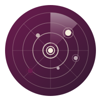
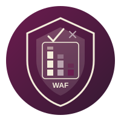
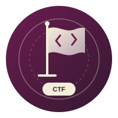

  <a href="https://hafezsecure.ir/en">
    <picture>
      <source media="(prefers-color-scheme: dark)" srcset="hafezsecure-logo-on-dark.svg">
      
    </picture>
  </a>

<h3 align="center">Result-Driven Cybersecurity</h3>

  
  
  
  

HafezSecure is a cybersecurity company headquartered in Tehran, Iran. We deliver advanced security solutions that reduce real risk, not just produce reports, from penetration testing and secure engineering to runtime protection and strategic advice.

## What we do

| Service area | What it covers |
|---|---|
| [Vulnerability Assessment & Pen Testing](https://hafezsecure.ir/en/services/assessment-pentest) | Security assessment and penetration testing of web applications, APIs, mobile apps, cloud, infrastructure and AI systems |
| [Build Secure](https://hafezsecure.ir/en/services/build-secure) | AI-native secure engineering, from SDLC and DevSecOps to AI coding governance, secure AI systems and continuous programs |
| [Protect & Monitor](https://hafezsecure.ir/en/services/protect-monitor) | Runtime protection and continuous monitoring, including WAF assessment and tuning, attack surface monitoring and vulnerability management |
| [Advisory](https://hafezsecure.ir/en/services/advisory) | Strategic consulting for security leaders: security strategy, architecture review, threat modeling, governance and metrics |

## Our platforms

Proprietary platforms that enable and amplify our security services. See [all products](https://hafezsecure.ir/en/products).

| | Platform | What it does | Deployment |
|---|---|---|---|
|  | **[VAaaS](https://hafezsecure.ir/en/products/vaaas)** Vulnerability Assessment as a Service | A scalable assessment platform combining expert-led testing, automation and AI-assisted analysis | Cloud or on-premises |
|  | **[ASM](https://hafezsecure.ir/en/products/asm)** Attack Surface Management | Continuous discovery and monitoring for visibility into exposed assets and external risk signals, with AI-powered prioritization | Cloud or on-premises |
|  | **[APEA](https://hafezsecure.ir/en/products/apea)** Application Protection Effectiveness Analyzer | Profile-level WAF effectiveness analysis, tuning validation and application-specific protection optimization | On-premises |
|  | **[ASAP](https://hafezsecure.ir/en/products/asap)** `Beta` Autonomous Security Assessment Platform | AI-driven autonomous security testing with logic-aware analysis, deep interaction and high-parallelism execution | Cloud or on-premises |
|  | **[HafezCTF](https://hafezsecure.ir/en/products/hafezctf)** `Beta` Security Training and Assessment Platform | Capture the Flag platform for assessment-grade competitions and hands-on learning paths | Your own infrastructure |

## How we work

**Result-driven · Risk-oriented · Expert-led · R&D-driven**

Our work follows the *Makth* (مکث) principle: meaning and substance over appearance, quality over quantity, and stability over aimless change. Our values are integrity, excellence, innovation and partnership.

## Latest insights

<!-- INSIGHTS:START -->
- [How to security-test an LLM application](https://hafezsecure.ir/en/insights/llm-application-security-testing) · 18 Sep 2026
- [What a penetration test report must contain](https://hafezsecure.ir/en/insights/pentest-report-contents) · 15 Sep 2026
- [Vulnerability assessment vs penetration test](https://hafezsecure.ir/en/insights/vulnerability-assessment-vs-penetration-test) · 15 Sep 2026
<!-- INSIGHTS:END -->

More guides and analyses on penetration testing, secure development, protection and monitoring in [Insights](https://hafezsecure.ir/en/insights). Open-source Burp Suite extensions and vulnerable-by-design training labs by our founder, [Moein Fatehi](https://github.com/moeinfatehi).

## Work with us

- **Need security help?** [Request a service](https://hafezsecure.ir/en/request-service) or [contact us](https://hafezsecure.ir/en/contact).
- **Want to join the team?** See [open positions](https://hafezsecure.ir/en/careers).

---

  <a href="https://hafezsecure.ir">وادی ایمن حافظ</a> · <a href="https://hafezsecure.ir/en">HafezSecure</a> · <a href="https://hafezsecure.ir/ar">حافظ سيكيور</a>

